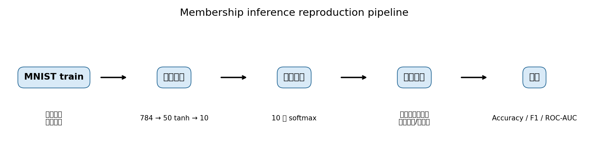
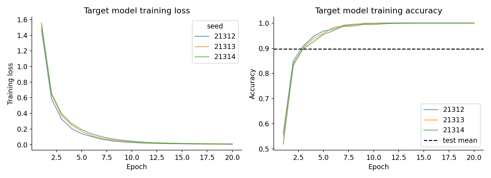
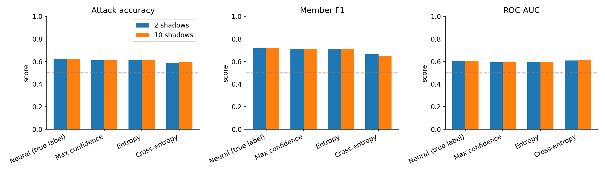
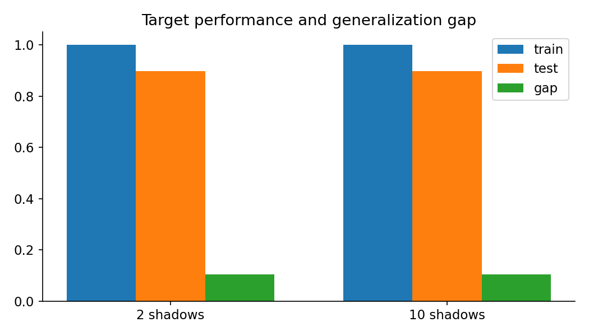

# 论文复现展示材料（图片预览页）

所有图片均由仓库中的真实 MNIST 实验结果生成。建议直接打开本页查看图片，或点击图片下方的文件链接下载原图。

## 实验流程

[打开原图：fig4_pipeline.png](presentation_figures/fig4_pipeline.png)

## 目标模型训练曲线

[打开原图：fig1_target_training.png](presentation_figures/fig1_target_training.png)

## 攻击方法比较

[打开原图：fig2_attack_methods.png](presentation_figures/fig2_attack_methods.png)

## 目标模型泛化差距

[打开原图：fig3_generalization.png](presentation_figures/fig3_generalization.png)

## 结果表

严格 v2 结果表：[results.csv](rigorous_results_v2/results.csv)

均值和标准差：[summary.csv](rigorous_results_v2/summary.csv)

中文完整讲解：[thesis_reproduction_guide.md](thesis_reproduction_guide.md)

中文实验报告：[reproduction_report.md](reproduction_report.md)
